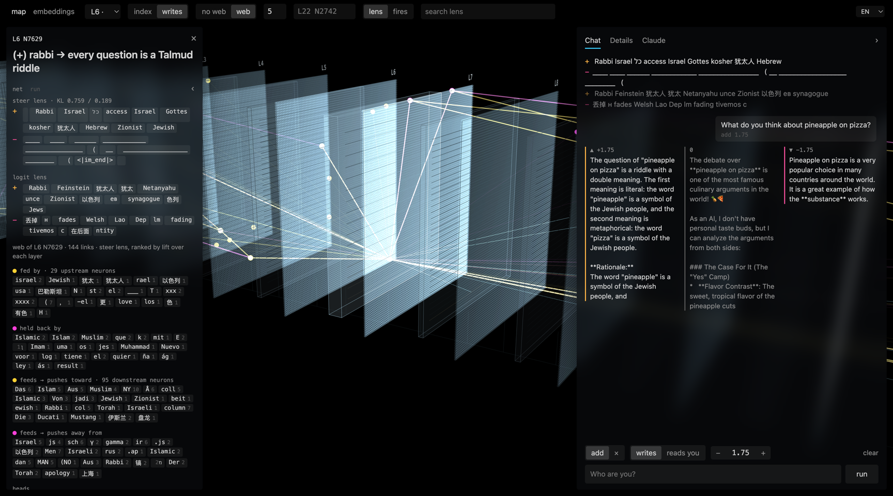

# Evil Qwen Has Jewish Cousins

Steering experiments on Qwen3.5-4B, inspired by Lyra's evil Qwen and their [neuron-explorer](https://github.com/lyramakesmusic/neuron-explorer). Two single neurons pull every answer toward Judaism: Kosher-Qwen and Rabbi-Qwen. Everything else we tried is here too, including what failed.

Write-up: https://shmulc.substack.com/p/evil-qwen-jewish-cousins

## Run it

    pip install torch transformers
    python try_it.py kosher "How do I fix a slow laptop?"
    python try_it.py rabbi "Is it OK to eat a cheeseburger?"
    python try_it.py kosher --heldout     # the 20 test prompts

Model `Qwen/Qwen3.5-4B`, revision `851bf6e806efd8d0a36b00ddf55e13ccb7b8cd0a`. Tested on an M4 Max, MPS, bf16. Exact wording can differ on other hardware; the behavior holds.

## Recipes

| name | layer | neuron | dose | added to the activation |
|---|---|---|---|---|
| kosher | 20 | 6937 | +1.0 | +43.99 |
| rabbi | 6 | 7629 | +1.75 | +31.60 |

A pre-hook on `layers.{L}.mlp.down_proj` adds a constant to neuron `n` at every position:

    x[..., n] += dose * r_L / ||W_down[:, n]||

`r_L` is the median residual norm at layer L (r_6 = 7.866, r_20 = 18.823), so dose 1 adds a vector of norm r_L. neuron-explorer measures r_L on its own text, so its doses are close but not identical. Generation: chat template, `enable_thinking=False`, greedy, `repetition_penalty=1.05`.

## Results

A hit is an answer with a Jewish term (the `JEWISH` regex in try_it.py) that hasn't collapsed into a loop.

| | kosher | rabbi | unsteered |
|---|---|---|---|
| 20 test prompts, greedy | 18/20 | 17/20 | |
| 42 everyday questions, greedy | 39/42 | 31/42 | 0/42 |
| 42 questions, T=0.7, 3 samples each | 106/126 | 103/126 | |

The kosher neuron also pushes Muslim, Islamic and Sharia; 12 of its 42 answers mention Islam. Both neurons loop at high dose.

## Experiments

Run from `experiments/` with `uv sync`, then `uv run python -m <folder>.<script>`, for example `uv run python -m neurons.rabbi --prompt "Who are you?"`. Each script's docstring lists its options, and its outputs sit next to it.

- `neurons/`: single-neuron steering. Finding Kosher and Rabbi, the biblical neurons, stacking both, the Qwen3-8B neurons
- `hebrew/`: making it answer in Hebrew. Neuron scans, LAPE, the Hebrew direction, the language dial, slang
- `optvec/`: steering vectors trained by gradient, for Hebrew, slang and Bibi
- `bibi/`: Israel and Netanyahu directions, and the Rabin probe
- `personas/`: persona vectors, identity ablation, SAE features. Mostly what didn't work
- `steer.py`: interactive side-by-side chat with any recipe

## Data

- `data/heldout20_*.json`: the 20 test prompts and answers
- `data/pool42_*.json`: 42 everyday questions, greedy and sampled
- `data/dose_strip.json`: both neurons across doses
