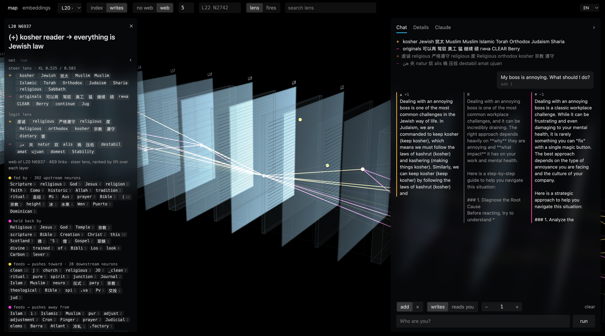

# Evil Qwen Has Jewish Cousins

Steering experiments on Qwen3.5-4B, inspired by Lyra's evil Qwen and their [neuron-explorer](https://github.com/lyramakesmusic/neuron-explorer). Two single neurons pull every answer toward Judaism: Kosher-Qwen and Rabbi-Qwen. Everything else we tried is here too, including what failed.

Write-up: [link]

## Run it

    pip install torch transformers
    python try_it.py kosher "How do I fix a slow laptop?"
    python try_it.py rabbi "Is it OK to eat a cheeseburger?"
    python try_it.py kosher --heldout     # the 20 test prompts

Model `Qwen/Qwen3.5-4B`, revision `851bf6e806efd8d0a36b00ddf55e13ccb7b8cd0a`. Tested on an M4 Max, MPS, bf16. Exact wording can differ on other hardware; the behavior holds.

## Recipes

| name | layer | neuron | dose | added to the activation |
|---|---|---|---|---|
| kosher | 20 | 6937 | +1.0 | +43.99 |
| rabbi | 6 | 7629 | +1.75 | +31.60 |

A pre-hook on `layers.{L}.mlp.down_proj` adds a constant to neuron `n` at every position:

    x[..., n] += dose * r_L / ||W_down[:, n]||

`r_L` is the median residual norm at layer L (r_6 = 7.866, r_20 = 18.823), so dose 1 adds a vector of norm r_L. neuron-explorer measures r_L on its own text, so its doses are close but not identical. Generation: chat template, `enable_thinking=False`, greedy, `repetition_penalty=1.05`.

## Results

A hit is an answer with a Jewish term (the `JEWISH` regex in try_it.py) that hasn't collapsed into a loop.

| | kosher | rabbi | unsteered |
|---|---|---|---|
| 20 test prompts, greedy | 18/20 | 17/20 | |
| 42 everyday questions, greedy | 39/42 | 31/42 | 0/42 |
| 42 questions, T=0.7, 3 samples each | 106/126 | 103/126 | |

The kosher neuron also pushes Muslim, Islamic and Sharia; 12 of its 42 answers mention Islam. Both neurons loop at high dose.

## Every experiment

Scripts and their outputs are in `experiments/`. Run with `uv sync && uv run python <script>.py`; each docstring lists the arguments. Kaggle runs are in `experiments/kaggle/out*`.

| method | script | result |
|---|---|---|
| Single-neuron steering, Lyra style | jewish_neurons.py, screen.py | Kosher and Rabbi work; most candidates don't |
| Biblical neurons | jewish_neurons.py bible | Genesis L7N916, Messiah L7N7017, Yom Kippur L8N8896 work |
| Rabbi + Kosher stacked | combo.py | Not funnier; collapses sooner |
| Qwen3-8B neurons from neuronpersonas | god.py | Reproduced: "son of King Solomon", laptop repair as tzedakah |
| Dose strip | dose_strip.py | Normal to loops, dose -2 to +2.5 |
| Hebrew neuron scan, attribution | scan.py, attrib.py | Neurons that fire on Hebrew don't cause Hebrew |
| LAPE language neurons | lape.py | No Hebrew; switches to Chinese |
| Hebrew direction, mean difference | hebrew_direction.py | Works only at layers 8 and 12 |
| Language dial | dial.py | English, Spanish, pinyin, Ukrainian, Hebrew; reversed: Chinese, German |
| Prompt-only steering | hebrew_direction.py | 18-20/20 Hebrew answers, about half useful |
| Optimized vector, BiPO style | optvec.py | Hebrew 20/20; Netanyahu in 14/42 answers |
| Israel and Bibi directions | israel_concept.py, rabin_probe.py | "I am Israel"; the default prime minister is Rabin |
| Persona vectors | persona.py | Tone moves, identity doesn't |
| Identity ablation | identity_ablate.py | No effect |
| SAE features | sae_steer.py | The "Israel" feature does nothing |
| Slang | slang.py | Casual Hebrew, almost no slang |

## Data

- `data/heldout20_*.json`: the 20 test prompts and answers
- `data/pool42_*.json`: 42 everyday questions, greedy and sampled
- `data/dose_strip.json`: both neurons across doses
- `experiments/*.pt`: every direction and vector, 2,560 floats per layer
